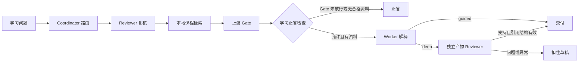

# 第十课：把重推理框架变成计算机知识学习助手

更新：2026-09-25。用户已选“计算机知识学习与推论助手”为第二项目方向。本课是第一个可运行 MVP，不代表最终产品或真实千问质量。

## 这次你要学会什么

同一个问题进入系统后，先由模型给出路由建议，再由 Reviewer 检查是否低估难度；程序把所有学习题约束为“先查本地课程资料”，最后由证据门禁决定能否给结论。概念题采用 `required+soft`，条件依赖或绝对化判断题采用 `required+strict`；严格路径要求至少两条合格证据，并调用工作副本已有的独立产物 Reviewer。该分类由模型与审查共同产生，示例只是预期行为，尚需真实模型验证。

这与普通问答的差别在于：`route → reviewer → workflow → retrieve → gate → worker → release` 每一步都有状态；资料不足时，学习助手不会把模型可能编出的内容当成答案。短期对话按 thread 保存并能跨进程恢复；本版不建立长期学习者画像，不自动生成 Skill。



## 源码怎么接起来

- 上游完整编排器在 `workbench/deepreason/src/reasoning_agent_template/multiagent.py`，工作流和检索分别在 `workflow.py`、`knowledge.py`。原有发布门禁见 `release_policy.py`。
- 本版新增 `workbench/deepreason/src/reasoning_agent_template/learning.py`。`LearningOrchestrator` 在上游编排器外加学习任务说明，把路由来源限制为本地 RAG；Gate 未放行或没有合格资料时，跳过 Worker 并返回受限结果。`LearningAssistant` 只汇总学习路径、结果状态和有来源的材料。
- 三份小型中文课程提要在 `workbench/deepreason/learning_mvp/knowledge/`，各自标明 OpenDSA 原文网址；它们不是“全量计算机知识库”，也不代表原书全文已导入。资料内容和用户画像分开存储。
- `BudgetedQwenClient` 用 SQLite 先占一次调用名额、再发请求；失败重试也计入。上限固定 100 次，跨本仓库工作区重启持续有效。本轮真实调用 0 次；测试中的模拟模型不计入真实用量。

## 正常、难题与失败案例

运行 `.venv/Scripts/python.exe scripts/learning_mvp_demo.py` 可在 `artifacts/analysis/learning_mvp_offline.json` 重建三条**脚本模型**轨迹：

| 案例 | 预期路径 | 观察到的门禁和调用 | 能说明什么 |
| --- | --- | --- | --- |
| “什么是哈希冲突？” | guided | 检索到本地资料；Gate allow；route、Reviewer、Worker 三次脚本调用 | 简单题仍需可追溯资料 |
| “哈希表一定比平衡二叉搜索树快吗？” | deep | 严格证据；三条资料合格；Gate allow；另有产物 Reviewer，共四次脚本调用 | 深题增加独立审查；结构核验不能证明语义正确 |
| 语料外的虚构缓存协议 | guided | 合格资料 0；原软 Gate 仍 allow；学习层跳过 Worker，标为 `abstained_no_evidence` | 上游软门禁与产品止答是两层不同判定 |

脚本答案只能证明流程与状态，不能证明真实模型会讲对。另有针对性测试：严格路径的产物 Reviewer 报告问题时，草稿被扣住并标记 `review_withheld`。第三例说明：上游软 Gate 的 `allow` 不是“找到资料”，所以本版增加了独立的学习止答规则。

首次运行还暴露一个可解释的参数问题：中文短问题命中哈希资料时，BM25 为 1.0、综合分数约 0.66，但“语义”子分数约 0.138，低于原门禁默认 0.25，导致证据被判不合格。本版只在学习场景把该子门槛设为 0.10，保留综合分数 0.45 门槛。这个改动仅由当前小样本支持；误命中、留出题与其他主题尚未评测，不能宣称总体效果提升。

## 你现在可以怎样运行

在 `workbench/deepreason` 下，使用本机 Python 3.11+ 和 `PYTHONPATH=src`：

```powershell
$env:PYTHONPATH='src'
..\..\.venv\Scripts\python.exe -m reasoning_agent_template.learning --usage
..\..\.venv\Scripts\python.exe -m reasoning_agent_template.learning --thread my-study '什么是哈希冲突？'
```

当前只完成离线验证。真实千问调用需本机事先配置 `DEEPREASON_QWEN_API_KEY` 或 `DASHSCOPE_API_KEY`；**不要把实际 Key 粘到聊天、文档或命令历史**。未配置 Key 时不会发请求。地域和模型默认取项目原先确认的北京兼容地址与 `qwen3.7-plus`，可用环境变量覆盖；尚未对真实账户实测。

## 下一步加什么

先拿一小批人工标注的概念题、条件比较题与无资料题，验证真实模型路由、回答依据、错误止答和每题调用数。随后把一个节点的 `input_contract` / `output_contract` 从展示字段升级为运行时可检查的交付快照，故障时记录为何停止。再讨论学习记录候选、Skill 提案与回滚；没有来源和用户核对，不把“自学习”写成已实现。
